# Creature Mart


## About

This is a shop for buying and collecting mystical creatures. However, it can be a template for creating your own store in telegram bot. You can try out the bot [here](https://t.me/Creature_Mart_bot)

## Starting

Use Python 3.11. Install the pinned dependencies in an isolated environment:

```sh
python -m venv .venv
# Windows: .venv\Scripts\activate
# Linux/macOS: source .venv/bin/activate
pip install -r requirements.txt
```

Copy `.env.example` to `.env` and fill in the bot token, administrator IDs, two
curator IDs and their links, the agreement URL and the support URL. Process
environment variables override `.env`. Relative paths are resolved from the project
directory, so `python /path/to/main.py` also works from another directory.

The existing six-line `data/text/config.txt` format remains supported as a fallback:
```
123456789 \ telegram token
123,123 \ telegram id admins, separated by commas
https://discord.gg/BGVGCcnx,https://discord.gg/BGVGCcnx \ tutor-maintenance links
https://telegra.ph/Polzovatelskoe-soglashenie-05-30-6 \ user acceptation link
123,123 \ telegram tutors ids, separated by commas
https://discord.gg/BGVGCcnx \ support link
```

Before updating an existing installation, stop the old process and back up its
SQLite database. Do not run the old and new versions against the same database.
Then start one polling process:

```commandline
python main.py
```

The database is initialized at startup. Existing `users`, `user_creature`,
`creatures` and `exchanges` data is preserved; additional tables store dialogs,
operation tokens, processed administrative commands, withdrawal requests and
notification delivery. Missing inventory rows are added without replacing existing
collections. A fresh installation imports all 47 original creatures, including
their numbers and prices, from `data/text/catalog.json`. This seed is only used
when the catalog table does not exist; it never overwrites an existing catalog.
`data/text/creatures.txt` is the original descriptive list, not the database seed.

The database, local configuration and Python caches are ignored by Git. Keep the
database and its backups private: they contain profile data, requisites and pending
confirmation codes. Actual token values must never be committed.

___

## Running

- Firstly, you need to solve a capcha

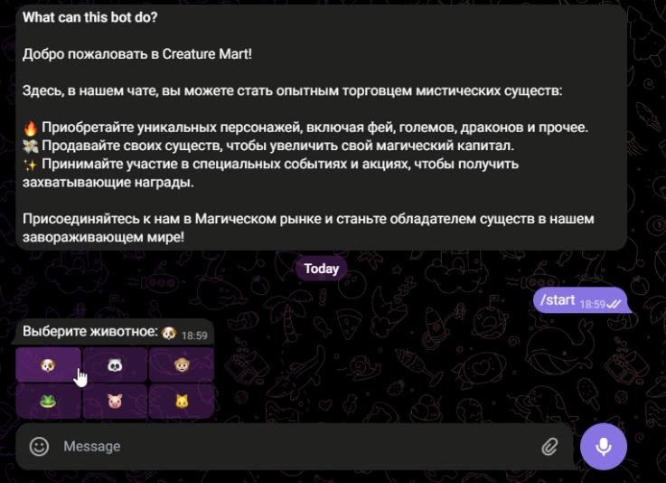


- And accept the user acceptation

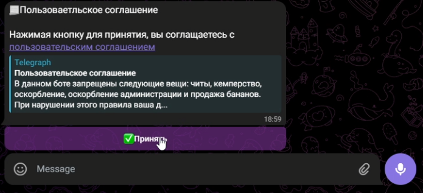


- After there actions you will see the main menu

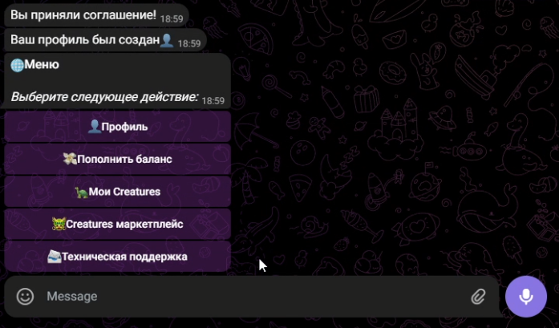


- If you click on 👤Профиль(profile), you will see your profile number, which is hidden and is telegram id

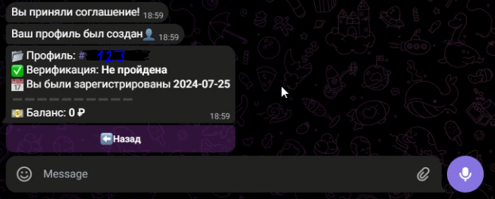


- If you click on 📨Техническая поддержка(support), you will see an instruction, how to request support, and a button with a link to the assistant

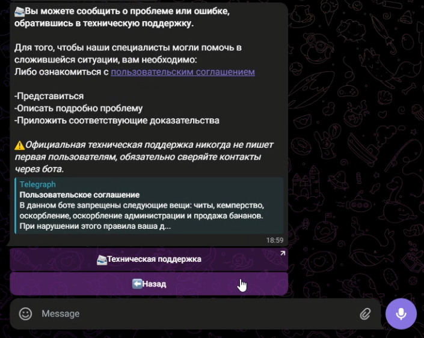


- If you click on 💸Пополнить баланс(top up your balance), you will see a message with minimum amount to deposit and with request to enter the required amount

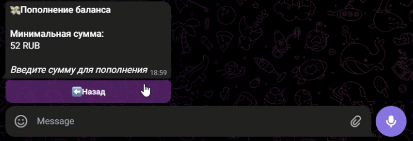


- After entering deposit amount, you will see a message with some choices to deposit   

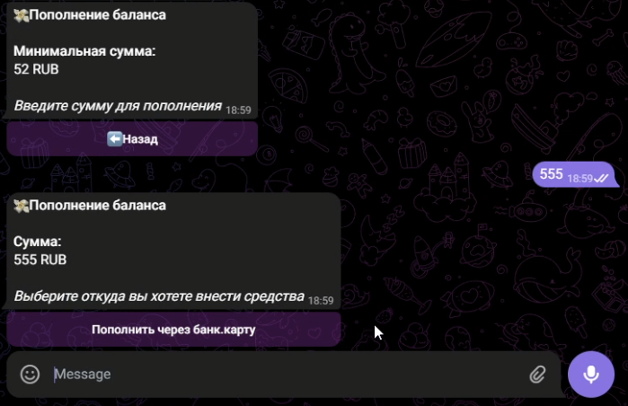


- After depositing you need to send a receipt to support using the link in the message

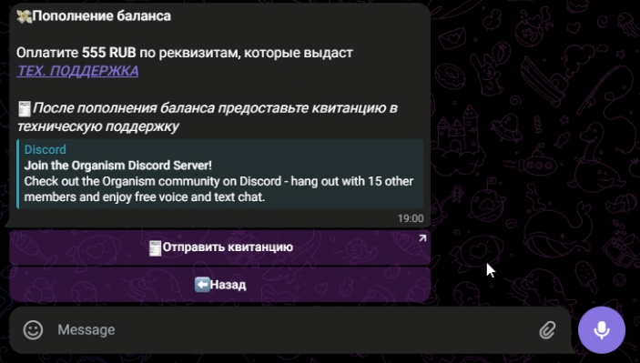


- If you click on 🐲Creatures маркетплейс(marketplace), you will see all collections of creatures, and you can choice a collection and creature. In the marketplace you have possibility to buy and sell your creatures

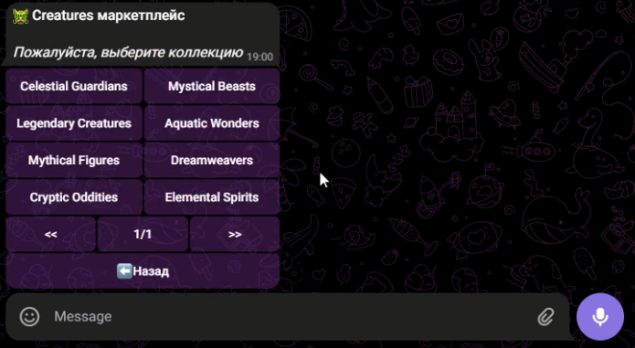
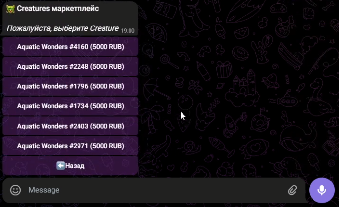
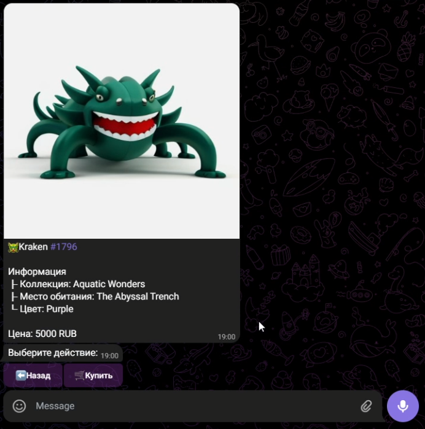


- After buying creature if you click on 🐢Мои Creatures(own collection), you will see all creatures you have

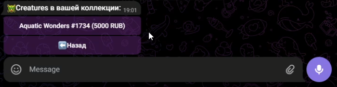

---

## Administration

- As for administration, if you send command `/admin`, you will see all information about admins possibilities

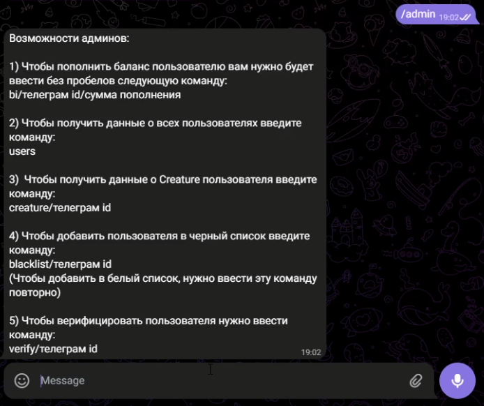

### Commands

1. `bi/id/amount` - will increase user balance, id - profile number (telegram id)
2. `users` - will show you all bot users
3. `creature/id` - will show you all creatures of a user (`createre/id` is accepted as an alias)
4. `blacklist/id` - will add user to blacklist
5. `verify/id` - will verify user profile
6. `gettable/name` - inspect `users`, `creatures`, `user_creature` or `exchanges`

Commands reject malformed IDs, missing users and non-positive amounts. Reprocessing
the same administrative message cannot apply a top-up or blacklist toggle twice.

## Behavior and compatibility

- The main interface uses one current bot message per chat: menu, profile,
  collections, creature cards, support and amount-entry dialogs edit this screen.
  Its message ID is stored in `ui_messages`, independently of dialog state, and
  survives restarts. `/menu`, `/start` and the inline **В меню** button return home.
  The old `Меню🌐` reply button remains supported for existing chats.
- Text screens use `editMessageText`, and creature photos use `editMessageMedia`.
  Returning from a photo to a text screen sends the replacement first and deletes
  only the previous panel. If Telegram refuses deletion, the previous message can
  remain, but further navigation targets the new screen. A missing or uneditable
  panel is recreated; network failures do not trigger duplicate sends.
  See the [Telegram editing methods](https://core.telegram.org/bots/api#updating-messages).
- Callback errors use alerts; trade results appear in the current screen. User
  messages, administrative reports and curator notifications remain separate.
  Existing chat history is not bulk-deleted. The bot no longer sends an additional
  reply-keyboard welcome message on every `/start` or registration.
- Registration requires the user's own captcha before accepting the agreement.
  `/start`, `/cancel` and `Меню🌐` recover interrupted dialogs. Access checks apply
  to all private-chat messages and callbacks, including old navigation buttons.
- Buying debits the current catalog price and adds the creature in one SQLite
  transaction. Selling through the existing market button credits the current
  catalog price only when the creature is owned. Duplicate clicks, foreign operation
  tokens, changed prices and stale buttons cannot repeat a completed transaction.
  An old purchase/sale button from before this update must be reopened from the menu.
- Captchas, amounts and confirmation codes belong to individual users and survive
  restarts. A legacy dialog whose amount existed only in old process memory must be
  restarted; the amount cannot be recovered from the original database.
- Deposits still use manual receipt verification and the administrator's `bi`
  command. No payment provider or automatic crediting was introduced.
- The existing `output_money` callback still creates a request for a curator.
  Confirmation does **not** execute a payment, reserve money or debit the balance:
  those steps did not exist in the original project. A curator must reconcile the
  current balance and previously processed requests before any external payout.
  The original menu did not expose a withdrawal button; no new button was added.
- Legacy `selling` / `exchanges` workflows remain supported. Prices are stored per
  application; requests at or below 10,000 RUB go to the first curator and larger
  requests to the second. Only the assigned curator can prepare a confirmation.
  The regular market sell button retains its immediate catalog-price behavior.
- Curator notifications are saved together with the request and retried after
  Telegram failures. Delivery is at least once: a crash after Telegram accepts a
  message but before SQLite records delivery can cause a duplicate notification.
  Confirmation and money changes remain protected against repeats. Cancelled
  requests may still have an already queued notification; their codes cannot
  confirm a cancelled request.
- SQLite work runs outside the event loop. Same-user updates are serialized within
  the polling process; database transactions also protect concurrent money changes.
  Bot sessions and background tasks close on shutdown.

## Dependencies and validation

The framework remains aiogram 3. It was upgraded from 3.6.0 to 3.31.0 because the
older release restricted aiohttp to 3.9.x. The pinned aiohttp 3.14.5 includes fixes
for the [HTTP response parser vulnerability](https://github.com/aio-libs/aiohttp/security/advisories/GHSA-cq5v-8q36-5273).
All runtime and development dependencies are pinned. The external `asyncio` package
was removed because asyncio is part of Python. Pillow was removed with the unused
image-rendering helper; the original image and font assets remain available.

```sh
pip install -r requirements-dev.txt
python -m pytest -q
python -m ruff check .
python -m ruff format --check .
python -m pip check
```

Tests use temporary databases and a fake Telegram session. They cover registration,
market navigation, buying and selling, authorization, stale callbacks, concurrent
operations, rollback on storage errors, independent deposits, manual withdrawal
requests, legacy curator sales, migration, notification retries and message editing.
Navigation tests check media transitions, screen recovery, repeated clicks and
isolation between chats. They do not
contact Telegram, send real messages, perform payments or modify the local working
database. Live Telegram permissions and external curator/payment procedures still
require a separate staging check with a test bot.
